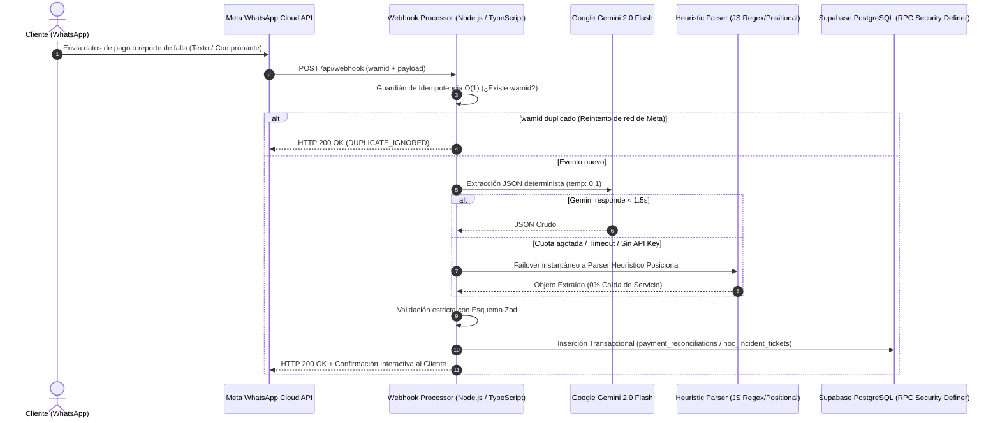

# WhatsApp + Gemini AI B2B Payment Conciliator & NOC Triage Engine (`whatsapp-gemini-conciliator`)

[](https://www.typescriptlang.org/)
[-8E75B2?style=flat&logo=googlegemini&logoColor=white)](https://ai.google.dev/)
[](https://developers.facebook.com/docs/whatsapp/cloud-api)
[](https://zod.dev/)
[](https://supabase.com/)

Motor serverless de **conciliación automatizada de pagos B2B y triaje de incidentes técnicos (NOC)** mediante **Meta WhatsApp Cloud API**, **Google Gemini 2.0 Flash** (`response_mime_type: "application/json"`, temperatura `0.1`), validación estricta con **Zod** y un **motor heurístico local de respaldo (*Zero-Downtime Fallback*)**.

> 💡 **Contexto de Producción:** Arquitectura desacoplada a partir de un motor en operación activa que procesa **+200 conciliaciones de pago y tickets de soporte mensuales en tiempo real**, eliminando el cuello de botella de transcripción manual en departamentos de cobranza y soporte técnico.

---

## 1. Diagrama de Secuencia y Resiliencia en Producción



---

## 2. Decisiones Clave de Ingeniería

1. **Extracción Híbrida con *Zero-Downtime Fallback* ([`src/conciliatorEngine.ts`](./src/conciliatorEngine.ts)):**
   * Los clientes en mensajería instantánea envían datos en formatos impredecibles: etiquetados (`"Cedula: V-19823411 Ref: 0094827162 Monto: 35.00 USD"`) o posicionales sin etiquetas (`"24910234 883920194 1420.50 BS Banesco"`).
   * Si la API de **Google Gemini** experimenta latencia o indisponibilidad, el motor conmuta automáticamente al analizador heurístico multicapa en JavaScript/TypeScript, garantizando que **ningún reporte de cobro ni ticket de falla se pierda**.
2. **Contratos de Datos Inmutables con Zod ([`src/schemas.ts`](./src/schemas.ts)):**
   * `PaymentReportExtractionSchema`: Normaliza identificador de cliente, número de referencia bancaria, monto numérico positivo, divisa (`USD | VES | EUR`) y entidad bancaria.
   * `TechnicalIncidentTriageSchema`: Clasifica fallas reportadas por el usuario en 5 categorías operativas (`OPTICAL_LOS`, `NO_DATA_LINK`, `INTERMITTENT_PACKET_LOSS`, `DNS_ROUTING`, `HIGH_LATENCY`), asigna severidad (`CRITICAL` a `LOW`) y determina automáticamente si requiere despacho de cuadrilla técnica a campo (`requiresFieldDispatch`).
3. **Idempotencia de Webhook ante Reintentos de Meta ([`src/webhookHandler.ts`](./src/webhookHandler.ts)):**
   * Meta WhatsApp Cloud API reintenta la entrega de webhooks si no recibe respuesta en tiempo. El procesador registra cada `messageId` (`wamid`) y descarta entregas duplicadas en $O(1)$, evitando cobros o tickets duplicados.

---

## 3. Ejecución Rápida del Simulador y Suite de Pruebas (En menos de 30 segundos)

No necesitas configurar claves de Meta ni de Google Gemini para auditar y probar el motor localmente:

```bash
# 1. Clonar e instalar dependencias
git clone https://github.com/anthony-huice/whatsapp-gemini-conciliator.git
cd whatsapp-gemini-conciliator
npm install

# 2. Verificar tipado estricto TypeScript
npm run typecheck

# 3. Ejecutar suite de pruebas unitarias (Extracción, Triaje NOC e Idempotencia)
npm test

# 4. Ejecutar el simulador interactivo con 5 payloads de WhatsApp Cloud API
npm run simulate
```

---

## 👤 Autor

**Anthony Yariff Huice Martínez** — *Desarrollador Full-Stack & Móvil*  
[LinkedIn](https://www.linkedin.com/in/anthony-huice) · [GitHub](https://github.com/anthony-huice) · [anthonyhuice92@gmail.com](mailto:anthonyhuice92@gmail.com)
